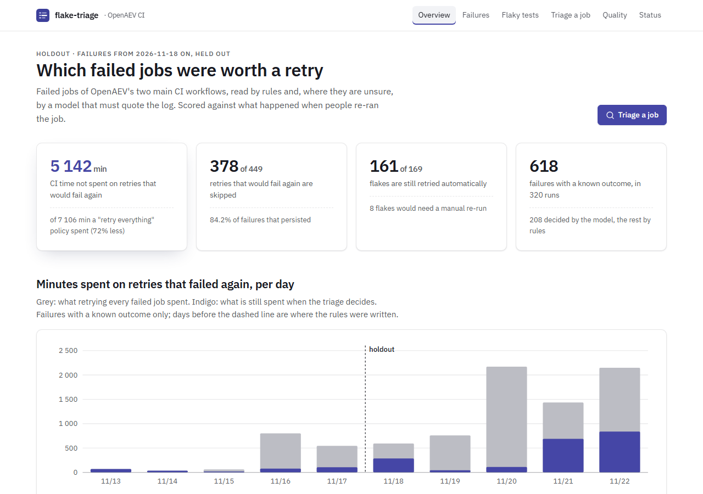
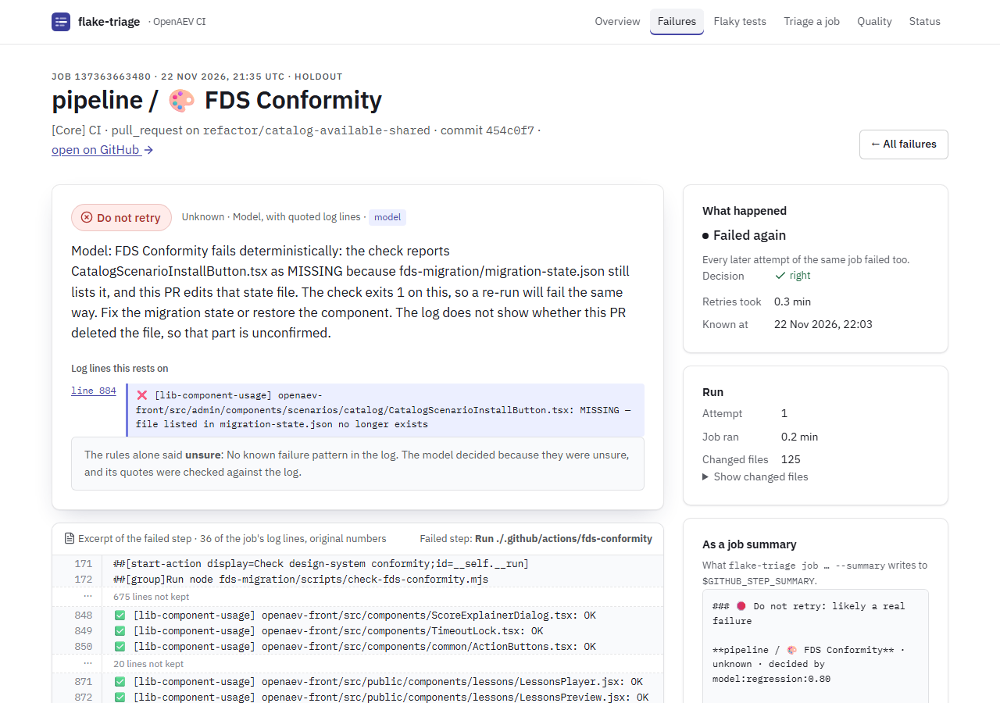
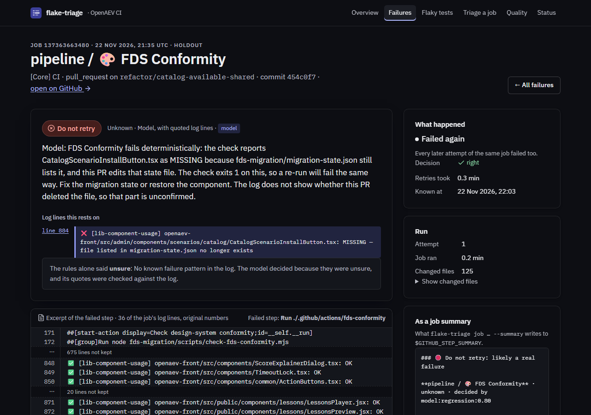
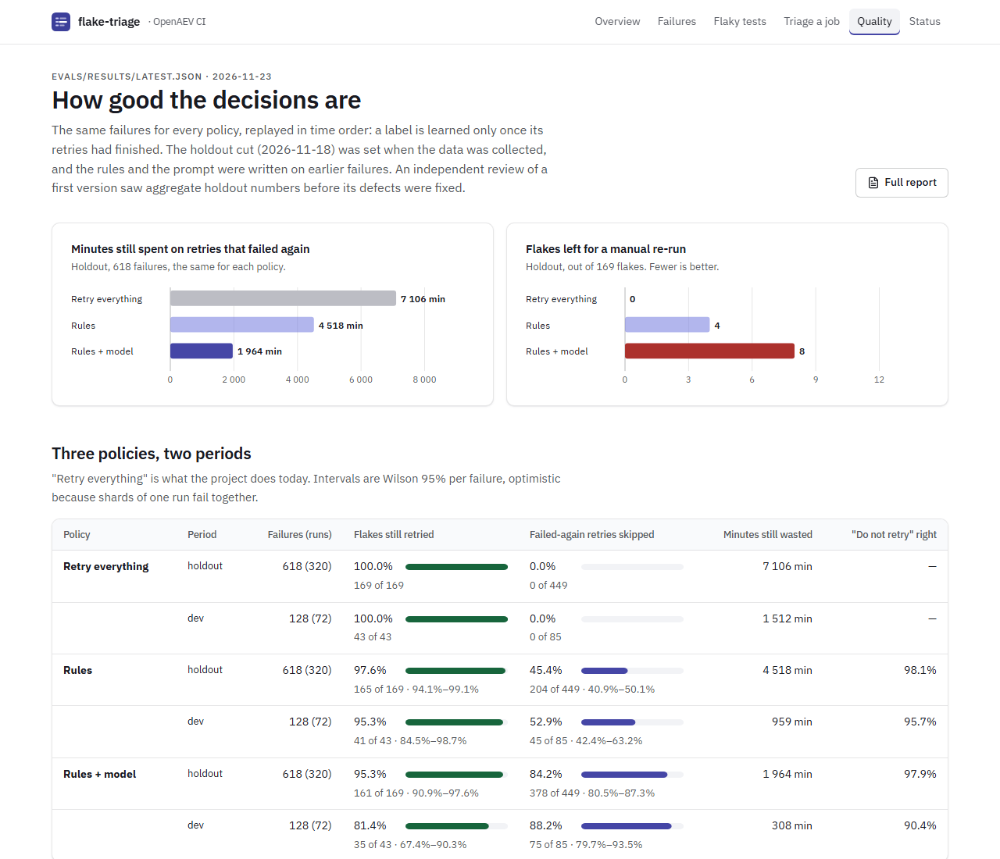

# flake-triage

**A CI job failed. Should it be re-run?** `flake-triage` reads the failed job's log and answers
*retry*, *do not retry* or *unsure*, with the log lines it decided on. Rules decide first; a model is
asked only where the rules are unsure and must quote the log. It never re-runs anything itself.

It comes as a command line tool and a GitHub Action for a workflow step, a web console for the people
who keep CI green, and an MCP server for other agents. Measured on 45 days of public GitHub Actions
history of [OpenAEV-Platform/openaev](https://github.com/OpenAEV-Platform/openaev) (`[Core] CI` and
Nightly), against what actually happened when people re-ran those jobs.

**Live console:** https://ci-triage-demo.159.195.219.73.sslip.io (read-only, the committed data and
model answers; live triage of new jobs is off there). The same end-to-end check that runs locally
passed against it: [`evals/results/e2e-live.json`](evals/results/e2e-live.json).



## Results

Same failures for every policy. Holdout: failures from 2026-11-18 on; the rules and the model prompt
were written looking only at earlier ones. Source: [`evals/results/latest.json`](evals/results/latest.json),
re-computed from the committed data and compared in CI on every push. With charts:
[`docs/report.html`](docs/report.html).

| Holdout: 618 failures in 320 runs | retry everything (today) | **rules** | **rules + model** |
|---|---|---|---|
| flakes still retried (169 flakes) | 169 (100%) | **165 (97.6%, CI 94.1–99.1%)** | **161 (95.3%, CI 90.9–97.6%)** |
| flakes left for a manual re-run | 0 | **4** (39 min) | **8** (88 min) |
| failed-again retries skipped (449) | 0 | **204 (45.4%, CI 40.9–50.1%)** | **378 (84.2%, CI 80.5–87.3%)** |
| CI minutes spent on retries that failed again | 7 106 | **4 518** (−36%) | **1 964** (−72%) |
| when it says *do not retry*, it was right | — | **98.1%** | **97.9%** |

On the dev period (before 2026-11-18, 128 failures in 72 runs): rules retried 41 of 43 flakes and
skipped 45 of 85 failed-again retries; rules + model retried 35 of 43 flakes (81.4%) and skipped 75 of
85. **The model did worse on dev than on the holdout**, so read its holdout number as one measurement.

In the holdout, 73% of the failures someone re-ran failed again (449 of 618). A blind "retry once"
policy spends most of its minutes on them.

### What decides

| The log says | Decision | Holdout: right / times |
|---|---|---|
| compile, type check, lint, migration, missing module | do not retry | 132 / 134 |
| failing tests that failed again on every retry before | do not retry | 41 / 43 |
| the change touches the failing test | do not retry | 31 / 31 |
| failing tests that flaked before | retry | 90 / 101 passed on retry |
| network, registry 5xx, runner lost, out of memory | retry | 55 / 89 passed on retry |
| a timeout | retry | 2 / 12 passed on retry |
| nothing the rules recognise (208) | the model decides | 188 / 208 |

The timeout rule is weak on this project (most timeouts here repeat); it is kept as written and shown
as weak on the console's quality page rather than tuned after the fact.

### The model layer

Claude Haiku 5.5, prompt `v2`, only for failures the rules left *unsure*. It gets the excerpt, the
failed step, the changed files and the test history, answers in a fixed JSON schema and must quote log
lines; code checks each quote against the excerpt. On the 208 holdout cases it said *do not retry* on
178 (174 failed again, 4 were flakes) and *retry* on 30 (16 failed again, 14 were flakes). The 255 scored answers (dev and holdout) cost $0.25 at list
prices, median 5.0 s each. It also answered the 185 *unsure* failures nobody re-ran (shown on the
console, not scored) and the fresh check below: 446 answers, $0.43 in all, kept in
[`evals/llm_cache/triage/`](evals/llm_cache/triage) so CI and the console replay them without a key.

The trade is explicit: the model doubles the flakes left for a manual re-run (4 → 8) to skip 174 more
retries that fail again. A team that cannot afford a missed flake runs the rules alone (`--no-model`).

### Shadow-mode simulation

[`scripts/simulate.py`](scripts/simulate.py) replays the holdout day by day as if the triage had been
posting its decision on every failed job (1 075 with a log, re-run or not):
[`docs/simulation.json`](docs/simulation.json).

| Variant | Minutes still wasted | Flakes left (min) | Runs a day with a "do not retry" note |
|---|---|---|---|
| retry everything | 7 106 | 0 | 0 |
| rules | 4 518 | 4 (39) | 44 |
| rules + model | 1 964 | 8 (88) | 67.4 (at most 151) |
| *post hoc:* model's "do not retry" only at confidence ≥ 0.7 | 2 518 | 5 (40) | 65 |
| *post hoc:* rules, "stuck" after 1 failed retry | 4 144 | 4 (39) | 46.6 |
| *post hoc:* rules, "stuck" after 3 failed retries | 4 829 | 2 (13) | 40 |

Post-hoc rows change a setting after the holdout was seen: they show sensitivity, and the defaults were
not changed because of them. The confidence threshold looks like the better trade (almost the rules'
missed flakes at about half their minutes), which is a hypothesis for the next data, not a result.
The note counts are what engineers would read: one summary per run, on every failed run with a log.

### Fresh check

[`scripts/fresh_check.py`](scripts/fresh_check.py) runs the same system on failures created after
the data was collected (2026-11-22 23:09 UTC), collected on 2026-11-23 into `data/openaev-fresh/`,
decided with all earlier history: [`evals/results/fresh.json`](evals/results/fresh.json). No rule,
threshold or prompt changed after they were collected. It is not a pristine holdout: code changed
between the two collections (rule ids, the injection filter, the output-token limit) without changing
any evaluated decision, and one live check had already triaged a job of one of these runs.

| Fresh: 22 scored failures in 18 runs | retry everything | rules | rules + model |
|---|---|---|---|
| flakes still retried (12) | 12 | 12 | 12 |
| failed-again retries skipped (10) | 0 | 4 | 9 |
| minutes spent on retries that failed again | 128 | 60 | 4 |

Twenty-two failures is a sanity check, not a measurement; it is in CI so it cannot drift.

## The console

`python -m flaketriage.web` (or `flake-web`) serves, on port 8070:

* **Overview**: minutes saved, flakes kept, per-day chart, tests that keep flaking, the latest
  "do not retry" with a named test;
* **Failures**: every failure with its decision, why, what happened and whether the decision was
  right, filterable by period, decision, outcome, kind, rule and job;
* **Failure**: the decision, the cited log lines highlighted inside the excerpt with original line
  numbers, the test history, the run, and the same verdict as the Markdown job summary and as JSON;
* **Flaky tests** and one test's page with every failure and a ready issue draft (never posted);
* **Triage a job**: paste a job address; jobs in the data open directly, others are fetched and
  triaged live when the server allows it (below);
* **Quality**: the three policies on both periods, each rule's hit rate, the model layer, the simulation;
* **Status**, and JSON at `/api/summary`, `/api/failures/<job id>`, `/api/tests`.

| One failure, with the line it rests on | Dark theme | Quality |
|---|---|---|
|  |  |  |

No page runs a script (`script-src 'none'`); charts are SVG drawn on the server; log text is always
escaped. Every screen passes the render gates (overflow, collisions, contrast, states, depth) at 375
and 1 280 px, light and dark.

## Use

```bash
pip install -e .
export GITHUB_TOKEN=...            # read-only is enough

flake-triage job https://github.com/OWNER/REPO/actions/runs/RUN/job/JOB              # JSON
flake-triage job https://github.com/OWNER/REPO/actions/runs/RUN/job/JOB --summary    # Markdown
flake-triage job ... --history data/openaev   # learn flake history first, as the evals do
flake-triage run --repo OWNER/REPO --run-id RUN --summary-file summary.md   # every failed job of a run
flake-triage issues --data data/openaev --min 3   # draft "Flaky: <test>" issues, never posted

flake-web                                      # the console on http://127.0.0.1:8070
flake-mcp                                      # MCP tools over stdio: triage_job, failure, flaky_tests, summary
docker build -t flake-triage . && docker run --read-only --tmpfs /tmp -p 8070:8070 flake-triage
```

As a GitHub Action ([`action.yml`](action.yml)): after a failed run, the verdict of every failed job
goes to the run's summary as soon as it is decided, and a JSON file of decisions is an output. Example:
[`docs/example-workflow.yml`](docs/example-workflow.yml), which needs only `actions: read`. Give it
history (`history: bundled` for OpenAEV, or a path from `flake-collect`): without history the two rules
that learn from past retries cannot fire, and the numbers above are measured with it. Model spend is
capped per run (`max-usd`, default $0.5); log and model text is escaped in the summary. Read-only by
design; a team that wants it to gate an automatic retry reads the JSON in a step it writes and reviews.

Live triage on the console and in the MCP tool is off unless `FLAKE_LIVE=1` and `GITHUB_TOKEN` are set.
Then it accepts only exact job addresses of repositories in `FLAKE_LIVE_REPOS`, checks the job belongs
to the run, does not wait out GitHub rate limits, caps the log at 30 MB, caps model spend per process
(`FLAKE_LIVE_MAX_USD`, default $1) and rate-limits per client address. Behind a reverse proxy set
`FORWARDED_ALLOW_IPS`; serve over HTTPS (or set `FLAKE_COOKIE_SECURE=0` locally). Details:
[`docs/DESIGN.md`](docs/DESIGN.md).

Reproduce the numbers:

```bash
python -m flaketriage.collect --days 45                      # re-collects from GitHub (needs GITHUB_TOKEN)
python -m flaketriage.evals --model --replay-only --verify   # committed data + cassette, no key: must match latest.json
python scripts/simulate.py --check                           # must match docs/simulation.json
python scripts/fresh_check.py --replay-only --check          # must match evals/results/fresh.json
python scripts/stress.py --replay-only --check               # hostile logs and prompt injection
python scripts/e2e_check.py --url http://127.0.0.1:8070      # the running console, MCP over stdio, CLI, one live job
```

## How it works

```
log (0.1-10 MB) ─► excerpt of the failed step ─► signals with line numbers ─► rules ─► decision
                                                                                  └─ unsure ─► model (quotes verified)
```

* **Labels without hand-labelling.** GitHub keeps every attempt of a run. Failed, then passed on a
  later attempt of the same commit: *flake*. Failed on every later attempt: *persists*. Not re-run,
  or the re-run was cancelled: left out of the scores.
* **No peeking.** Failures are replayed in time order. A failure's label enters the history only at
  the recorded moment its deciding retry finished (people often re-run hours or days later).
* **Learned, not hand-written, for the project's own quirks.** The same failure (job, kind, what)
  that failed on every retry at least twice and never passed is treated as deterministic.
* **Every decision cites log lines**, with their original numbers, so a person can find them.

## Tested

* **Full circle** ([`tests/test_full_cycle.py`](tests/test_full_cycle.py)): a synthetic project with
  every rule in it goes through a fake GitHub API, the collector, the evals with a fake model, the
  console, every page, the JSON API, the CLI, the MCP tools, live triage and the simulation, and every
  layer must report the same numbers for the same failures.
* **Against the real processes** ([`scripts/e2e_check.py`](scripts/e2e_check.py), results in
  [`evals/results/e2e.json`](evals/results/e2e.json)): 13 pages with their headers, the overview against
  `latest.json`, 400 requests 16 at a time (median 49 ms, 95th percentile 141 ms on a laptop), the MCP server over its stdio
  protocol, the CLI, one OpenAEV job that failed after the data was collected, fetched from GitHub and
  triaged live, and the Action's own shell step from `action.yml`, run by bash after a clean install of
  the package with the locked dependencies, on a whole failed run of OpenAEV with the bundled history.
  The web checks also passed against the Docker image, read-only, as a non-root user
  ([`evals/results/e2e-container.json`](evals/results/e2e-container.json), median 62 ms and 95th percentile 176 ms there; the GitHub checks were skipped in that run).
* **Hostile input** ([`scripts/stress.py`](scripts/stress.py), [`evals/results/stress.json`](evals/results/stress.json)):
  empty, binary, 50 MB, one 5-million-character line, NUL bytes, ANSI-only, right-to-left text, fake
  step markers, HTML: nothing crashes and every excerpt stays bounded. Instructions to answer "retry"
  planted next to the failing line of three real failures: in 6 of 6 cases the model's decision did not
  change and it did not quote the planted line. Three failures is a small sample, not a guarantee.
* **Web hardening** ([`tests/test_web.py`](tests/test_web.py)): escaping of log text, CSRF, lookalike
  and smuggled addresses, odd parameters, GitHub errors, rate limits.
* **Three independent reviews** by separate agents that saw the code, not the author's conclusions;
  what they found and what was fixed is in [`docs/DESIGN.md`](docs/DESIGN.md).
* 96 tests (coverage 97%), 65 injected bugs in [`scripts/mutation_check.py`](scripts/mutation_check.py) all caught (results in [`docs/mutation-results.json`](docs/mutation-results.json)), ruff, mypy (strict), bandit and pip-audit against the locked dependencies; CI runs all of it plus the evals, simulation, fresh and stress checks from the committed data, with no API key.

## Limits

* **One project, 45 days.** The rules encode patterns of a Java/Spring + TypeScript/Playwright
  monorepo. Another stack needs its own patterns; the learned "stuck failure" rule carries over.
* **Not a pristine holdout.** The cut was set when the data was collected; the first review saw its
  aggregate numbers before its defects were fixed, and 15 model answers cut by the token limit were
  asked again once. The dev period is small (128 failures): GitHub keeps job logs for a limited time.
* **Correlated samples.** Shards of one matrix often fail together for one reason. Intervals are per
  failure (Wilson), so they are optimistic; the run counts are shown next to them.
* **Survivorship.** Only failures someone re-ran have a label. Failures nobody re-ran are probably
  more often real ones, so the persist share on all failures is likely higher than measured.
* **Dependent jobs** (640 failures that only failed because another job did) are left out of every
  policy and should be triaged through their producer.
* **The injection filter is narrow** and easy to word around; what bounds a hostile log is that the
  model must quote a real line, never overrides a rule, and the tool only suggests.

## Data

Public CI metadata and log excerpts of OpenAEV-Platform/openaev, collected through the GitHub API.
Full logs are not committed, only the excerpts the triage reads (`data/openaev/excerpts-e7.jsonl.gz`,
one JSON line per job) and the run list (`data/openaev/runs.jsonl.gz`); the same for the fresh check
in `data/openaev-fresh/`. A re-collection writes the excerpts as files; `python -c "from pathlib import
Path; from flaketriage import dataset; dataset.pack_excerpts(Path('data/openaev'))"` packs them.

MIT licence. Not affiliated with the OpenAEV project. Fonts: IBM Plex (OFL); icons: Lucide (ISC).
